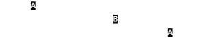
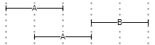
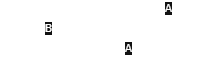
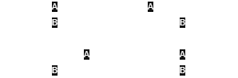
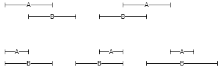
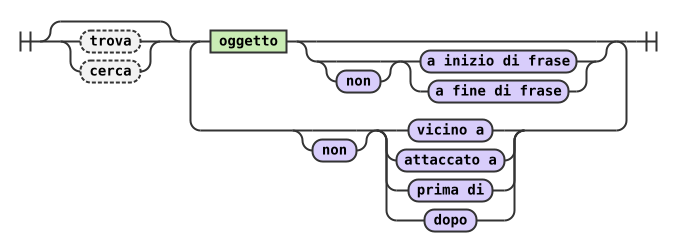
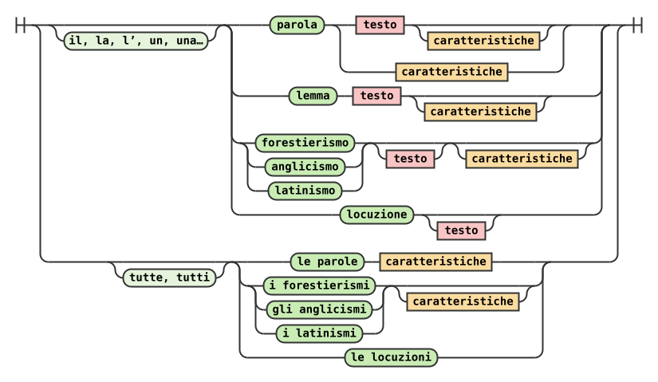
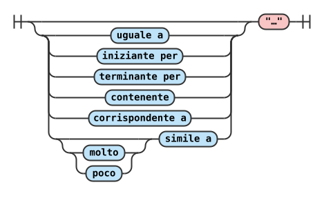
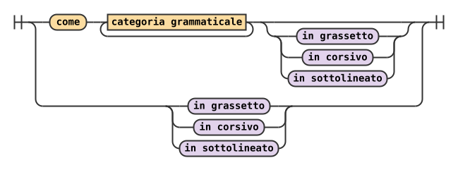

# Query

- [Query](#query)
  - [Pair](#pair)
    - [Pair Name](#pair-name)
    - [Structures](#structures)
    - [Pair Value](#pair-value)
    - [Pair Operator](#pair-operator)
  - [Logical Operators](#logical-operators)
  - [Location Operators](#location-operators)
    - [Arguments](#arguments)
    - [Near](#near)
    - [Before](#before)
    - [After](#after)
    - [Inside](#inside)
    - [Overlaps](#overlaps)
    - [Lalign](#lalign)
    - [Ralign](#ralign)
    - [Combining Location Operators](#combining-location-operators)
  - [Precedence](#precedence)
  - [Sections](#sections)
  - [Results](#results)
  - [Errors](#errors)
  - [Higher Order Languages](#higher-order-languages)

The Pythia query language is used to build SQL-based queries from much simpler expressions.

💡 [Details about translation](sql) from this language to SQL.

As explained about the [Pythia model](index#model), the index is just a set of _objects_, which in most cases represent _tokens_ ("words"), but can also represent sentences, verses, paragraphs, or any other text _structure_. All these objects are _spans_ of text, i.e. sequences of one or more tokens, defined by their start and end token positions in their document. Each span has any number of metadata (named _attributes_). A search gets to these objects via their metadata.

So, a search essentially matches an attribute with a value using some comparison type. This matching is the core of any search, and represents what is called a _pair_, i.e. the union of an attribute's name with a value via a comparison operator. Even searching for a word is rather searching for the tokens whose `value` attribute is equal to that word.

A query can consist of a _single pair_, or connect _more pairs_ with a number of logical or positional (location) operators, optionally defining precedence with parentheses. You start finding the spans matching a pair, and then add more conditions by means of operators connecting multiple pairs.

## Pair

Each pair, whatever the entity it refers to, is wrapped in square brackets, and includes a name, an operator, and a value, or just a name when we just test for its existence (for non-privileged attributes only: see below). The query syntax is thus:

```txt
[NAME OPERATOR "VALUE"]
```

For instance, `[value="example"]` finds all the tokens whose value is `example`.

### Pair Name

The name is just the name of any valid attribute for the type of object we want to search. Attribute **names** are case-insensitive. A name is an identifier, i.e. it starts with a letter or underscore, followed by letters, underscores, digits, or dashes.

From the point of view of the user all the attributes are equal, and can be freely queried for each item, either it is a document, a token, or a structure. Yet, internally some of these attributes are **privileged**, in the sense that they are considered _intrinsic_ properties of the objects.

>🔧 Privileged attributes are stored in a different way in the index, as they are directly assigned as intrinsic properties of objects. All the other attributes, which are extensible, are rather linked to objects and stored separately from them.

The names of privileged attributes are reserved; so, when defining your own attributes, avoid using these names for them. The reserved names are:

- _document_'s privileged attributes: `id`, `author`, `title`, `date_value`, `sort_key`, `source`, `profile_id`. Among them, `id` and `date_value` are numeric.
- _span_'s privileged attributes: `p1`, `p2`, `index`, `length`, `language`, `pos`, `lemma`, `value`, `text`, `lemma_id`, `word_id`. Among them, `p1`, `p2`, `index`, `length`, `lemma_id` and `word_id` are numeric.

A pair with a non-privileged attribute can omit operator and value, to just test for the existence of the attribute: e.g. `[gn]` finds all the tokens having an attribute named `gn` (whatever its value). Privileged attributes always exist, so they require an operator and a value.

### Structures

Pairs without any prefix refer to **tokens**. Pairs prefixed with `$` refer instead to **structures**, i.e. any span which is not a token (sentence, verse, paragraph, etc.):

- `$NAME` alone finds all the structures of type `NAME`: e.g. `[$l]` finds all the verses (structures of type `l`), and `[$snt]` all the sentences. This is a shortcut for `[$name="NAME"]`.
- `$name` with an operator and a value compares the type of structures: e.g. `[$name="l"]` is equivalent to `[$l]`; `[$name^="l"]` finds all the structures whose type starts with `l`.
- `$ATTR` with an operator and a value refers to any other attribute of structures, privileged or not. For instance, `[$value="pro tempore"]` finds all the structures whose value is `pro tempore`, whatever their type; `[$l="1"]` finds all the structures having an attribute named `l` equal to `1`.

To find the structures of a type having some attribute value, combine pairs with `AND`: e.g. `[$fp-lat] AND [$value="pro tempore"]` finds all the Latin phrases (structures of type `fp-lat`) whose value is `pro tempore`.

>The legacy syntax `[_ATTR...]` (and `[$_ATTR...]`), where `_` is the prefix for the attribute of a structure, is still accepted as an alias of `[$ATTR...]`. So, `[$fp-lat] AND [_value="pro tempore"]` is equivalent to `[$fp-lat] AND [$value="pro tempore"]`.

### Pair Value

Attribute **values** are always included in double quotes `""`, even when they are numeric. The syntax of the value may vary according to the operator selected. For instance, if you are using a wildcard matching operator, characters `?` and `*` will represent wildcards rather than literals.

Values can include _escapes_ with the form `&HHHH;` where `HHHH` is the Unicode hex (BMP) character code to be represented. This is the only way to include a double quote in a value (`&0022;`).

### Pair Operator

The available pair operators are 14, inspired by CSS attribute selectors. All the textual comparisons are **case-insensitive**.

- `=` **equals** (textual comparison, literal).
- `<>` **not equals** (textual comparison, literal). Spans having no value for the attribute (e.g. a token without `language`) never match this operator.
- `*=` **contains** (literal).
- `^=` **starts with** (literal).
- `$=` **ends with** (literal).
- `?=` **wildcards**. Allowed wildcards are `?`=any single character, and `*`=any number of any characters. Any other character is literal (including `%` and `_`, which are wildcards in SQL). Without wildcards, this is the same as `=`.
- `~=` **regular expression** (PostgreSQL POSIX regular expressions, case-insensitive).
- `%=` **fuzzy matching** with a treshold. The default treshold value is 0.9; you can specify a different treshold by adding it to the end of the value, prefixed by `:`. For instance, `[value%="chommoda:0.75"]`, or just `[value%="chommoda"]` to use the 0.9 treshold. The similarity is the trigrams similarity of PostgreSQL, in a range from 0 (completely different) to 1 (equal).
- **numeric** comparison operators: `==`, `!=`, `<`, `>`, `<=`, `>=`. The value must be a number (an optional sign, digits with an optional decimal part introduced by `.`, and an optional exponent like `e3`), or the query is rejected.

>🔧 Technically, attributes values are all modeled as strings, so that they can represent anything; but when using numeric operators, these values will be converted into (and thus treated as) numeric values, ignoring those which are not numbers. This implies that in constrast with systems like e.g. Lucene, where numeric values are handled as strings so that for instance you have to store `0910` to let it compare correctly with `1256`, this is not required for Pythia; here, you just have to use the numeric operators, which implicitly cast the string value into a number.

Numeric privileged attributes (like `p1` or `length`) are always compared as numbers, so they also accept `=` and `<>`, but no textual operator. For instance, `[length>"9"]` finds all the tokens longer than 9 characters, and `[len>"9"]` does the same with a non-privileged attribute `len` whose values are numbers.

Thus, for instance this pair:

```txt
[value="example"]
```

just finds the word "example". Here, you can replace the `=` operator with any other one (except of course the numeric operators, as in this sample we are looking for text); so, you might type:

```txt
[value^="exam"]
```

to find all the words starting with `exam`, or:

```txt
[value$="ple"]
```

to find all the words ending with `ple`; etc.

>When the search is configured with literal filters (e.g. an Italian filter which removes diacritics and lowercases letters), they are applied to the values compared with the `value` attribute of tokens with operators `=`, `<>`, `*=`, `^=`, `$=`, and to the literal parts of `?=` values, so that these values match the filtered values of tokens in the index. They are not applied to any other attribute, nor to structures.

Of course, you are not limited to a single pair. Multiple pairs can be _connected_ via logical or location operators, and precedence can be expressed by parentheses.

## Logical Operators

Logical operators connect pairs (or expressions) referring to the **same span**:

- `AND`: the span must match both expressions. For instance, `[value="ionios"] AND [gn]` finds the tokens with value `ionios` having an attribute `gn` (geographic name).
- `AND NOT`: the span must match the first expression and not the second one. For instance, `[pos="NOUN"] AND NOT [number="plur"]` finds all the nouns which are not plural, including those without any `number` attribute.
- `OR`: the span must match any of the expressions. For instance, `[value="chommoda"] OR [value="commoda"]`.

`OR NOT` is allowed only in the document section (see [below](#sections)): in the text section it would match any span not matching its right operand.

Note that `AND` refers to the same span, so it would make no sense to connect two different tokens with it, like `[value="sic"] AND [value="mater"]` (no token can have two different values). To find tokens in some relation, use location operators.

## Location Operators

Location operators connect two expressions, A (on the left) and B (on the right), by their position in the same document. The result is always made of spans of A: they are filtered so that only those A spans which have (or, when negated, which do not have) at least one B span in the required position are kept. For instance, `[value="sic"] BEFORE(m=0) [value="mater"]` finds all the `sic` tokens immediately followed by a `mater` token.

All the positions are based on token positions. Every span has a start (`p1`) and an end (`p2`) position; for tokens, they coincide.

All the location operators can be **negated** by prefixing a `NOT`, e.g. `NOT NEAR`: the result is then made of the A spans which have no B span in the required position.

### Arguments

Location operators have zero or more **arguments**, expressed between parentheses after their name. Arguments can be specified in any order; each is prefixed by its name, followed by an equals sign and its value. For instance, `BEFORE(m=0,s=l)` specifies arguments `m` with value 0, and `s` with value `l`. Parentheses are required even when there are no arguments, e.g. `NEAR()`.

The arguments are:

| argument | operators | value | default | meaning |
|---|---|---|---|---|
| `n` | all except INSIDE | integer (0-N) | 0 | minimum distance (or overlap) |
| `m` | all except INSIDE | integer (0-N) | unlimited | maximum distance (or overlap) |
| `ns` | INSIDE | integer (0-N) | 0 | minimum distance of A start from B start |
| `ms` | INSIDE | integer (0-N) | unlimited | maximum distance of A start from B start |
| `ne` | INSIDE | integer (0-N) | 0 | minimum distance of A end from B end |
| `me` | INSIDE | integer (0-N) | unlimited | maximum distance of A end from B end |
| `s` | all | structure type | none | A and B must be inside the same structure of this type |

- each argument can appear only once; minimum values cannot be greater than the corresponding maximum values.
- `s` requires a structure of the specified type including both A and B. For instance, `[value="sic"] NEAR(m=3,s=l) [value="mater"]` finds `sic` within 3 tokens from `mater`, when both are inside the same verse. This way, we are not limited to a mechanical numeric criterion, which might be misleading when e.g. one word happens to be at the end of a sentence, and the other one at the beginning of the next one.
- `s` can also be used with negated operators, meaning that there must be no B span in the required position inside the same structure including A: e.g. `[value="sic"] NOT NEAR(m=3,s=l) [value="mater"]` finds the `sic` tokens which have no `mater` within 3 tokens in their verse.

The **distance** between two spans is the count of positions between them: e.g. two adjacent tokens have distance 0. The operators are defined as follows.

### Near

▶️ `NEAR(n,m,s)`: A is _near_ B, i.e. either before or after it, at a distance from `n` to `m`. For instance, in Figure 1 A is either before or after B; the distance between the left A and B is 1, while the distance between B and the right A is 0. A and B must not overlap; so, a span is never near to itself.



- Figure 1 - NEAR

### Before

▶️ `BEFORE(n,m,s)`: A is _before_ B, i.e. A ends before B starts, at a distance from `n` to `m`: B.p1 - A.p2 - 1 is between `n` and `m`. For instance, in Figure 2 two instances of A are before B, either at distance 1 or 0.



- Figure 2 - BEFORE

### After

▶️ `AFTER(n,m,s)`: A is _after_ B, i.e. A starts after B ends, at a distance from `n` to `m`: A.p1 - B.p2 - 1 is between `n` and `m`. This operator mirrors `BEFORE`. For instance, in Figure 3 two instances of A are after B, either at distance 1 or 0.



- Figure 3 - AFTER

### Inside

▶️ `INSIDE(ns,ms,ne,me,s)`: A is _inside_ B, i.e. A starts with or after B and ends with or before B, optionally at the specified minimum and/or maximum distance from B start (A.p1 - B.p1 between `ns` and `ms`) or end (B.p2 - A.p2 between `ne` and `me`). For instance, in the 4 examples of Figure 4 A is always inside B, whatever its relative position and extent.



- Figure 4 - INSIDE

### Overlaps

▶️ `OVERLAPS(n,m,s)`: A _overlaps_ B, i.e. they share at least one position; here `n` and `m` are the minimum and maximum count of shared positions (as at least one position is always shared, `n` is at least 1). For instance, in the 4 examples of Figure 5 there is always overlap (of extent 1) between A and B.



- Figure 5 - OVERLAPS

### Lalign

▶️ `LALIGN(n,m,s)`: A is _left-aligned_ with B: A can start with or after B, but not before B; here, `n` and `m` specify the minimum and maximum offsets from B start (A.p1 - B.p1). For instance, in Figure 6 the left A/B pair has a perfect left alignment (distance=0), while the right pair has offset=1 from the left-alignment position. So, a word at the start of a sentence is just a word left-aligned with a sentence with `m=0`: `[value="sic"] LALIGN(m=0) [$snt]`.


- Figure 6 - LALIGN

### Ralign

▶️ `RALIGN(n,m,s)`: A is _right-aligned_ with B: A can end with or before B, but not after B; here, `n` and `m` specify the minimum and maximum offsets from B end (B.p2 - A.p2). This mirrors `LALIGN`. For instance, in Figure 7 the left A/B pair has a perfect right alignment (distance=0), while the right pair has offset=1 from the right-alignment position.


- Figure 7 - RALIGN

💡 The potential of these alignment operators may not be immediately evident, but they can provide a lot of power for contextual searches. Remember that in Pythia everything is an object with properties (including start/end positions), whether it's a single word or a larger linguistic structure like phrase, sentence, verse, or even non-strictly linguistic structures like typographic entities as paragraphs. Such objects all have a start and an end position, making them like segments. So, once any span of text, whatever the analysis level which defined it, has been defined in this geometrical way, you are free to look for any type of alignment between any types of segments, and additionally play with the operation arguments for minimum, maximum, and embracing structure. Once again, this is the effect of a higher abstraction level in the model, the same which "de-materialized" text from a sequence of characters into a set of objects.

>⚙️ The search translates these definitions into conditions on the positions of spans. The database also provides an equivalent function for each operator (e.g. `pyt_is_near_within`), for use in your own SQL code.

### Combining Location Operators

Each side of a location operator can be any expression. For instance, `[value="sic"] BEFORE(m=0) ([value="mater"] OR [value="liber"])` finds `sic` immediately before `mater` or `liber`.

Location operators are **right-associative**: a chain like `A BEFORE B BEFORE C` means `A BEFORE (B BEFORE C)`, i.e. A is filtered by B, which in turn is filtered by C. For instance, `[value="sic"] BEFORE(m=0) [value="mater"] BEFORE(m=0) [value="sic"]` finds a `sic` immediately followed by `mater`, which in turn is immediately followed by another `sic`. To filter A by more conditions, use parentheses: e.g. `([value="sic"] BEFORE(m=0) [value="mater"]) AFTER(m=5) [value="credo"]` finds a `sic` immediately followed by `mater`, and following `credo` within 5 tokens.

Location expressions can also be combined with logical operators: e.g. `([value="sic"] NEAR(m=0) [value="mater"]) OR [value="chommoda"]`.

## Precedence

From the highest to the lowest precedence, the operators are:

1. `AND`, `AND NOT`;
2. `OR` (and, only in the document section, `OR NOT`);
3. location operators.

Operators with the same precedence are evaluated from left to right, except location operators, which are evaluated from right to left. Use parentheses to change the order. For instance:

- `[value="sic"] OR [value="et"] AND [pos="CCONJ"]` means `[value="sic"] OR ([value="et"] AND [pos="CCONJ"])`.
- `[value="chommoda"] OR [value="sic"] NEAR(m=0) [value="mater"]` means `([value="chommoda"] OR [value="sic"]) NEAR(m=0) [value="mater"]`.
- `[pos="NOUN"] AND [number="plur"] NEAR(m=2) [pos="VERB"]` means `([pos="NOUN"] AND [number="plur"]) NEAR(m=2) [pos="VERB"]`.

## Sections

Text objects (tokens and structures) are not the only available objects in Pythia; there are also documents and corpora. These are used to further delimit the results to documents matching a specific query, or to predefined sets of documents (corpora).

To allow for a simpler syntax, conditions about corpora, documents, and text are specified in three different sections of a query:

1. **corpus** filters (optional). The corpus section is just a list of corpora IDs in `@@...;`, separated by spaces. For the section to match, it is enough to match any of the listed corpora IDs. IDs are case-insensitive; those which are not identifiers (e.g. starting with a digit or including a dot) must be wrapped in double quotes, e.g. `@@"2024.acts" neoteroi;`.

2. **document** filters section (optional). The documents set is represented by an expression of pairs inside `@...;`, connected by `AND`/`OR`/`AND NOT`/`OR NOT`, and optionally grouped by `()`. Pairs refer to document attributes, either privileged (like `author` or `date_value`) or not. Each pair is evaluated separately, so that e.g. `@[category="poetry"] AND [date-value<"-40"];` finds the documents having both these attributes.

3. **tokens** and **structures** section (required). An expression of pairs, each inside `[...]`, connected by logical or location operators, and optionally grouped by `()`.

The corpus and document sections define the search scope: all the spans in the text section, on both sides of location operators, must belong to the documents in the scope.

Thus, a query's skeleton is (whitespaces are not relevant, but I place sections in different lines just to make the query more readable):

```txt
@@...corpus...;
@...document...;
...tokens and structures...
```

where only the last section is required.

As a sample, consider this query:

```txt
@@neoteroi rhetoric;
@[author="Catullus"] AND ([date_value<="0"] OR [category="poetry"]);
[value="hionios"] OR ([value="sic"] BEFORE(m=0,s=l) [value="mater"] BEFORE(m=0,s=l) [value="sic"])
```

Here we have:

- a _corpus_ section, limiting the search to the documents in any of the corpora `neoteroi` and `rhetoric`.

- a _documents_ section, including 3 pairs for author, category, and date value, connected by logical operators and grouped with parentheses. Here we must match all the documents whose author is `Catullus`, having either their category equal to `poetry` or their date value less than or equal to `0` (which for these documents means B.C.). This limits the search only to the documents matching these criteria.

- a _text_ (=tokens/structures) section, including 4 pairs; the first pair (`hionios`) is an alternative match for the second expression, including another value (`sic`). This value is further filtered by its location with reference to the next 2 words, `mater` and `sic` again. As location operators are right-associative, `mater` adds a filter to the first `sic`; in turn, the second `sic` adds a filter to `mater`. This means that we must match a token with value `sic`, but only before a token with value `mater` at a distance of no more than 0 token positions (`m=0` means a maximum distance of 0), and inside the same verse (`s=l` means a common structure named `l`=line); in turn, this `mater` must appear immediately before another `sic`, and inside the same verse. So, at line 5 of Catullus' poem 84, dated one century before Christ, `credo, >sic mater, sic< liber avunculus eius`, this query matches the first `sic` only as it happens to be immediately followed by `mater`, which in turn must be immediately followed by another `sic`.

The following picture represents the syntax tree for a shorter version of the above query:

```txt
@[author="catullus"] AND ([category="poetry"] OR [datevalue<"0"]);[value="sic"] BEFORE(m=0,s=l) [value="mater"]
```


## Results

The results of a query are the spans matching its text section, each with its document's author, title, and sort key. A span is never repeated in the results, and the total count of results is the count of distinct spans.

By default, results are sorted by span value, document sort key, and position; the API also allows specifying other sort fields. Results with equal sort values are always sorted by span ID, so that paging is deterministic.

## Errors

A query is rejected with an error, telling the position of the offending part, when:

- it is not syntactically valid, including any text which follows a complete query (e.g. `[value="a"] [value="b"]`), or any invalid character;
- a privileged attribute has no operator and value (e.g. `[value]`);
- a numeric operator, or any operator for a numeric privileged attribute, has a value which is not a number;
- a textual operator is used with a numeric privileged attribute (e.g. `[p1*="1"]`);
- a location operator has an unknown, repeated, or invalid argument (e.g. `NEAR(ns=1)`, `NEAR(m=1,m=2)`, `NEAR(s=1)`), or a minimum value greater than the corresponding maximum value.

## Higher Order Languages

The Pythia query language as described above is thus very powerful, but for some audiences it might just be too much. This is the case for a part of the audience targeted by the frontend built for the [Atti Chiari](https://attichiari.unige.it) project, code-named Minerva, which addresses not only linguists and jurists, but also a broader public of non-specialized users.

In this case, it is right the abstraction level adopted by this model which allows to provide alternative ways of querying the same index. More generally, Pythia just stores its index in a standard [relational database](storage) (currently PostgreSQL), which allows third parties to reuse it in any way, independently from its software. But even within this software stack, like in the case of Minerva, the high abstraction level easily provides alternatives.

In the case of Minerva, a new query layer has been added on top of the existing one, acting as an alternative, "simple" query language, as opposed to the default one illustrated above. This is just another DSL, targeting an Italian audience and much nearer to natural language expression.

In this DSL, users just build some predefined Italian sentences to query the corpus. Apart from the simplest, one-word query, which just corresponds to the word you want to find, Figure 8 shows the structure of a sentence, from left to right: an optional command, an object to find, and an optional position.



- Figure 8 - The Minerva additional DSL: sentence

The object can be a single word ("parola"), lemma ("lemma"), Latin phrase ("locuzione"), or foreign word ("forestierismo", "anglicismo", "latinismo"), with an optional article; or a set of them, like "tutte le parole", "tutti i latinismi", "le locuzioni" (Figure 9). Words and lemmata are followed by the text to find, optionally preceded by a comparison like "iniziante per", "terminante per", "contenente", "corrispondente a" (for wildcard matches), or "(molto/poco) simile a" for fuzzy matches (Figure 10).



- Figure 9 - The Minerva additional DSL: object



- Figure 10 - The Minerva additional DSL: text

Most objects can then be followed by features (Figure 11): the "come" clause introduces one or more search criteria derived from POS tagging, like noun, adjective, verb, one of its specific moods or tenses, etc.; and an "in" clause adds search criteria related to typographic features (extracted from the original DOCX documents), like bold, italic, or underline.



- Figure 11 - The Minerva additional DSL: features

Finally, we can add a positional clause, like at sentence start or end, or near to, attached to (=near with zero distance), before, or after another object, optionally negated by "non".

In most cases, where these criteria require parameters the DSL supplies some meaningful defaults, thus hiding more complex details to the end users. Once the query expression is complete, it gets translated into the default DSL illustrated above, thus allowing users to have a glance at it if they want to learn it by example, or just customize some of its parameters.

Thus, users can just ask the system 'trova un anglicismo poco simile a "provider"' and get this Italian sentence automatically translated into a query like:

```txt
[language="eng"] AND [value%="provider:0.5"]
```

This query just looks for any word having both these properties:

- language = English;
- value similar to "provider" with a similarity threshold equal to 0.5 (in a range from 0 to 1, where 1 is equal).

The query will thus find any English word which is broadly similar to "provider". Should you just want to find any foreign word in these Italian texts, you could just replace "anglicismo" with "forestierismo", and get a slightly different query:

```txt
[language<>"ita"] AND [value%="provider:0.5"]
```

In this case, the DSL has built a query which finds any non-Italian word, as of course in this case we deal with an Italian corpus, where any non-Italian word is considered as foreign. On passage, legal acts are full of foreign words especially drawn from Latin, and this is thus a very useful feature in linguistic or juridic searches.

Speaking about Latin, this DSL also allows for searching not just a single word, but also a full phrase, as in most cases juridic texts use them in a highly formular way. This is made possible by the fact that the underlying Pythia engine deals with any span of text, representing any type of textual structure, whether it's a word, or a phrase, sentence, verse, etc. In this case, a query expression like 'trova la locuzione "pro tempore"' would thus be translated into `[$fp-lat] AND [$value="pro tempore"]`, where `$` is the prefix used for non-token spans ("structures") and `fp-lat` the name chosen during indexing for Latin foreign phrases.

Of course, any valid path along the expression tree can be exploited; so one might modify this expression like 'trova la locuzione iniziante per "pro"' to get `[$fp-lat] AND [$value^="pro"]`, or 'terminante per "tempore"' to get `[$fp-lat] AND [$value$="tempore"]`; in both cases, the only difference is the comparison operator.

Again, we could add more clauses about the relative position of the text being searched, like in 'trova la parola "invero" a inizio di frase'; this would be translated into:

```txt
[value="invero"] LALIGN(m=0) [$snt]
```

which means looking for a word whose value is equal to "invero", left-aligned with a sentence object, only when the maximum distance (`m`) from its start is 0. This will effectively find that word only when it appears at the beginning of a sentence.

Even these short sample expressions should be enough to show how they can be a powerful way for exploiting the potential of the underlying engine while preserving a very easy user experience. In fact, in Minerva this additional query layer just builds on top of the base one, as a higher-order DSL. In this case, we have a twofold translation:

1. the Italian query DSL is translated into the base query DSL.
2. the base query DSL is translated into [SQL](sql).

Alternatively, Minerva users can also use the base query DSL, either directly or from a translated expression (when they want to modify it); in both cases, we will end up with the same SQL code. Of course, a third-party software might either use these DSLs, or just bypass them and use its own, or even no DSL at all, when directly talking to the underlying database engine via SQL or some helper tool (e.g. an ORM mapping technology).

>⚙️ Technically, both DSLs are defined via [ANTLR](antlr); in the case of the Pythia engine, ANTLR generates a C# parser integrated in its backend, while in the case of Minerva its additional DSL is limited to the frontend it applies to, so there ANTLR generates a Typescript parser directly leveraged in the UI. To inspect the results of DSL to SQL translation you can also use the [Pythia CLI tool](cli#build-sql-command).

Finally, an even more natural addition implemented in Minerva on top of this DSL is the consequence of using natural-language like expressions for it: in fact, as an alternative input method the UI leverages the browser's builtin speech recognition capabilities to let users just say what they want to find. In this case, the speech is converted into text, validated and integrated by the software (for instance to introduce quotes around the values being searched), and finally translated just as it had been entered by typing it. This provides an additional and very natural way for querying this index, especially fit to wider audiences.
