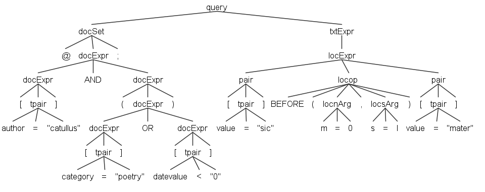

# SQL Translation

- [SQL Translation](#sql-translation)
  - [Query Translation](#query-translation)
    - [Walking the Tree](#walking-the-tree)
  - [Query Overview](#query-overview)
  - [Anatomy](#anatomy)
    - [1. Scope CTE](#1-scope-cte)
    - [2. Filter CTEs](#2-filter-ctes)
    - [3. Result CTE](#3-result-cte)
    - [4. Merger Query](#4-merger-query)
  - [Performance](#performance)

The Pythia default implementation relies on a RDBMS. So, querying a corpus means querying a relational database, which allows for a high level of customizations and usages by third-party systems.

Of course, users are not required to enter complex SQL expressions; rather, they just type queries in a custom domain specific language (or compose them in a graphical UI), which gets automatically translated into SQL.

>🔧 The current Pythia implementation is based on PostgreSQL. The repository implementation anyway relegates most PostgreSQL-specific SQL to a separate code object (the SQL helper), while putting most of the logic in a shared code object.

## Query Translation

A [Pythia query](query), as defined by its own domain specific language ([via ANTLR](./antlr)), gets translated into SQL code, which is then executed to get the desired results. You can find the full grammar under `Pythia.Core/Assets/pythia.g4`, and its corresponding C# generated code under `Pythia.Core/Query`.

To **play with the grammar**, you can use the [ANTLR4 lab](http://lab.antlr.org/):

1. paste the grammar in the left pane under the heading "Parser". Also, be sure to clear the "Lexer" pane completely.
2. in the "Start rule" field, enter `query`.
3. type your expression in the "Input" pane, and click the "Run" button.

>All the SQL components non specific to a particular SQL implementation are found in the `Pythia.Sql` project. PostgreSQL-specific components and overrides are found in `Pythia.Sql.PgSql`. `SqlQueryBuilder` parses the query (throwing a `PythiaQueryException` at any lexical or syntax error), and uses `SqlPythiaTranslator` to translate its parse tree into SQL. Another query builder is `SqlWordQueryBuilder`, which is used to browse the words and lemmata index.

### Walking the Tree

🛠️ This is a technical section.

The translator walks the query parse tree recursively. The text expression (`txtExpr`) is translated into nodes of two kinds:

- **filters**: conditions on a single span, i.e. a pair, or pairs connected by `AND`, `AND NOT`, or `OR`. As all these pairs refer to the same span, they are combined into a single SQL condition, which can use indexes: e.g. `[pos="NOUN"] AND [number="plur"]` becomes a single condition on spans, rather than the intersection of all the nouns with all the plurals.
- **relations**: SQL queries returning spans. Each filter used as an operand becomes a CTE (`sN`) selecting the spans matching it. Location operators produce a query selecting the spans of their left operand which have (or have not) a span of their right operand in the required position; logical operators between relations become `INTERSECT` (`AND`), `EXCEPT` (`AND NOT`), or `UNION` (`OR`).

For reference, here is a sample query tree:



The document and corpus sections are translated into a single scope query, selecting the IDs of the documents in the search scope.

## Query Overview

- 💡see [storage](storage) for information about the RDBMS schema.

From the point of view of the database index, in a search we are essentially finding _spans_ inside _documents_. Each span (token or structure) has 2 positions: a start position (`p1`), and an end position (`p2`). Positions are counted by tokens, so for tokens by definition `p1` is always equal to `p2`. This might seem redundant, but it allows for handling both object types with the same model.

We get to spans by means of metadata (_attributes_ in Pythia lingo). Some of these are intrinsic to a span, and are known as _intrinsic_ (or _privileged_) attributes, stored as columns of the `span` table; others can be freely added during analysis, without limits, and are stored in the `span_attribute` table. The same applies to documents (`document` and `document_attribute`).

## Anatomy

The SQL query has these parts:

1. an optional scope CTE (`d`), with the IDs of the documents in the search scope.
2. a list of filter CTEs (named like `s1`, `s2`, etc.), each selecting the spans matching a filter.
3. a result CTE (`r`), combining the filter CTEs according to the query.
4. a final merger query which joins `r` data with additional information and provides sorting and paging; or just counts the results.

### 1. Scope CTE

The corpus and document sections become a query selecting the IDs of the documents in scope. For instance, `@@neoteroi;@[author="Catullus"] AND [category="poetry"];[value="chommoda"]` produces:

```sql
WITH d AS MATERIALIZED
(
SELECT document.id FROM document
WHERE ((-- author EQ "Catullus"
LOWER(document.author) = LOWER('Catullus'))
AND (-- category EQ "poetry"
EXISTS (SELECT 1 FROM document_attribute AS da WHERE da.document_id = document.id AND LOWER(da.name) = LOWER('category') AND LOWER(da.value) = LOWER('poetry'))))
AND (EXISTS (SELECT 1 FROM document_corpus AS dc WHERE dc.document_id = document.id AND LOWER(dc.corpus_id) IN (LOWER('neoteroi'))))
) -- d
```

Privileged document attributes are columns of `document`; each other attribute is tested by its own `EXISTS` subquery, so that several attributes can be combined with any logical operator. The filter CTEs then include the condition `span.document_id = ANY ((SELECT array_agg(id) FROM d)::int[])`. The scope is an array rather than a subquery, because a join with `d` would let PostgreSQL find the spans of the right operands of location operators by document (via `d`) rather than by position. The right operands of location operators need no scope at all, as their spans must be in the same document of a span of the left operand, which is in scope.

### 2. Filter CTEs

As we have seen, the core components of each query are represented by matching objects attributes, in the form `name operator value`. Each filter (a pair or a combination of pairs) becomes a CTE, selecting the matching spans.

For instance, this is the CTE for the query `[value="chommoda"]`:

```sql
WITH s1 AS NOT MATERIALIZED
(
SELECT span.id, span.document_id, span.type, span.p1, span.p2, span.index, span.length, span.value
FROM span
WHERE (
-- p1: value EQ "chommoda"
span.type = 'tok' AND LOWER(span.value) = LOWER('chommoda')
)
) -- s1
```

Non-privileged attributes are tested with an `EXISTS` subquery on `span_attribute`, e.g. for `[pn="arrius"]`:

```sql
span.type = 'tok' AND EXISTS (SELECT 1 FROM span_attribute AS sa WHERE sa.span_id = span.id AND LOWER(sa.name) = LOWER('pn') AND LOWER(sa.value) = LOWER('arrius'))
```

Structure pairs test the span type, e.g. `[$lg]` becomes `span.type = 'lg'`, and `[$value="pro tempore"]` becomes `span.type <> 'tok' AND LOWER(span.value) = LOWER('pro tempore')`.

The operators are translated as follows (all textual comparisons are case-insensitive):

| operator | SQL |
|---|---|
| `=` | `LOWER(col) = LOWER('v')` |
| `<>` | `LOWER(col) <> LOWER('v')` |
| `*=`, `^=`, `$=` | `LOWER(col) LIKE LOWER('%v%') ESCAPE '!'` (or `v%`, `%v`), with `%`, `_` and `!` in the value escaped by `!` |
| `?=` | like the above, with `*` and `?` translated into `%` and `_` |
| `~=` | `col ~* 'v'` |
| `%=` | `LOWER(col) % LOWER('v') AND similarity(LOWER(col), LOWER('v')) >= T`; the `%` operator (which can use trigram indexes) is used only when T is not less than the similarity threshold set for search connections (0.3) |
| `==`, `!=`, `<`, `>`, `<=`, `>=` | `col OP N` for numeric columns; else `(CASE WHEN pyt_is_numeric(col::text) THEN col::text::double precision END) OP N` |

Numeric values are validated and normalized before being inserted into SQL, and all the text values are SQL string literals, so that values can never alter the SQL code.

CTEs are `NOT MATERIALIZED`, so that PostgreSQL can merge their conditions into the queries using them, and use indexes.

### 3. Result CTE

The result CTE `r` contains the SQL of the text expression. In the simplest case, it just selects all the rows from a filter CTE:

```sql
, r AS MATERIALIZED
(
SELECT * FROM s1
) -- r
```

A location operator selects the spans of its left operand (`a`) for which there exists (or, when negated, there does not exist) a span of its right operand (`b`) in the same document and in the required position. The position conditions are expressed on the columns of `b`, so that indexes on positions can be used. For instance, `[value="sic"] NEAR(m=0,s=l) [value="mater"]` produces:

```sql
, l1 AS MATERIALIZED
(
SELECT COALESCE(MAX(span.p2 - span.p1), 0) AS len FROM span WHERE span.type = 'l'
) -- l1
, r AS MATERIALIZED
(
-- NEAR(n=0,m=0,s=l)
SELECT a1.* FROM s1 AS a1
WHERE EXISTS (SELECT 1 FROM s2 AS b1
  WHERE b1.document_id = a1.document_id AND ((b1.p1 = a1.p2 + 1)
    OR (b1.p2 = a1.p1 - 1))
  AND EXISTS (SELECT 1 FROM span AS c1 WHERE c1.document_id = a1.document_id AND c1.type = 'l' AND c1.p1 <= LEAST(a1.p1, b1.p1) AND c1.p1 >= GREATEST(a1.p2, b1.p2) - (SELECT len FROM l1) AND c1.p2 >= GREATEST(a1.p2, b1.p2)))
) -- r
```

Here, the structure including both spans (`c1`) cannot start before the end of both spans minus the maximum length of the structures of its type (`l1`): this bound lets PostgreSQL find it among a few structures, rather than among all the structures of the document. The same bound (with the maximum length of the spans of the right operand) is used by `INSIDE` and `OVERLAPS`.

The position conditions are:

| operator | conditions on B |
|---|---|
| `BEFORE(n,m)` | `b.p1` between `a.p2 + 1 + n` and `a.p2 + 1 + m` |
| `AFTER(n,m)` | `b.p2` between `a.p1 - 1 - m` and `a.p1 - 1 - n` |
| `NEAR(n,m)` | `BEFORE` or `AFTER` |
| `INSIDE(ns,ms,ne,me)` | `b.p1` between `a.p1 - ms` and `a.p1 - ns`, and `b.p2` between `a.p2 + ne` and `a.p2 + me` |
| `OVERLAPS(n,m)` | `b.p1 <= a.p2` and `b.p2 >= a.p1`, and overlapping positions count between `n` and `m` |
| `LALIGN(n,m)` | `b.p1` between `a.p1 - m` and `a.p1 - n` |
| `RALIGN(n,m)` | `b.p2` between `a.p2 + n` and `a.p2 + m` |
| `s=TYPE` | a structure of type `TYPE` in the same document includes both A and B |

Unlimited maximum values just omit the corresponding condition.

An operand which is not a filter CTE (e.g. another location expression) is used as a subquery, so that all the conditions of nested expressions are preserved. For instance, `[value="sic"] BEFORE(m=0) [value="mater"] BEFORE(m=0) [value="sic"]` (where location operators are right-associative) becomes:

```sql
-- BEFORE(n=0,m=0)
SELECT a2.* FROM s1 AS a2
WHERE EXISTS (SELECT 1 FROM (
-- BEFORE(n=0,m=0)
SELECT a1.* FROM s2 AS a1
WHERE EXISTS (SELECT 1 FROM s3 AS b1
  WHERE b1.document_id = a1.document_id AND b1.p1 = a1.p2 + 1)
) AS b2
  WHERE b2.document_id = a2.document_id AND b2.p1 = a2.p2 + 1)
```

As each span of the left operand is kept at most once, the result never contains duplicates.

### 4. Merger Query

The final merger query joins the results with more details from documents, and applies sorting and paging:

```sql
SELECT r.id, r.document_id, r.p1, r.p2, r.type,
r.index, r.length, r.value,
document.author, document.title, document.sort_key
FROM r
INNER JOIN document ON r.document_id = document.id
ORDER BY r.value, document.sort_key, r.p1, r.id
LIMIT 20 OFFSET 0
```

The last sort field is always the span ID, so that paging is deterministic. The count query instead is just `SELECT COUNT(*) FROM r`.

## Performance

These are the main design choices made for performance:

- filters combine all the pairs referring to the same span in a single condition, rather than intersecting or uniting the sets of spans matching each pair.
- location operators are `EXISTS` (or `NOT EXISTS`) subqueries, which PostgreSQL executes as semi-joins (or anti-joins): each span is kept as soon as a matching span is found, without producing a row for each matching pair of spans.
- position conditions are plain comparisons of span positions, rather than function calls, so that they can use the positional indexes on spans (`type, document_id, p1, p2` and `type, document_id, p2, p1`). There are no indexes on positions alone, as positions are meaningful only within a document, and such indexes would mislead the planner.
- structures including other spans (`s` argument, `INSIDE`, `OVERLAPS`) are searched only among those starting within the maximum length of their spans.
- the scope is an array of document IDs, rather than a subquery (see above).
- the database has statistics on the lowercase values of span attributes (`LOWER(value)`, `LOWER(lemma)`, `LOWER(pos)`, `LOWER(language)`), so that the planner can estimate how many spans match a pair.
- the result CTE is materialized, so that it is computed once and then sorted; otherwise, for a page of results PostgreSQL might scan an index sorted by value hoping to find the first matches early, which with rare matches means scanning almost the whole index.
- fuzzy matching uses the trigram `%` operator (when its threshold allows it), which can use trigram indexes.

The database functions for location operators (`pyt_is_near_within`, etc.) and `pyt_is_numeric` are plain SQL expressions, which can be inlined by PostgreSQL. They are kept for third-party SQL code, but the search does not use the location functions.
